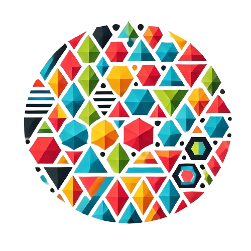

#  PolyDiM

**PolyDiM** (POLYtopal DIscretization Methods ) is a numerical computational library designed for solving partial differential equations (PDEs) using discretization methods that operate on generic polytopal (polygonal/polyhedral) meshes.

PolyDiM is inspired by and built upon the foundational research of the Numerical Analysis Group in the Department of Mathematical Sciences "Giuseppe Luigi Lagrange" (DISMA) at the Politecnico di Torino.

See the official documentation at the [official website](https://polydim.it/) for the main guide to install the library.

This file can be used by citing references in CITATION.cff file.

**PolyDiM-core** is the core of the library and requires [**GeDiM-core**](https://github.com/AURION-Polito/GeDiM-core) and [**3rd_party_libraries**](https://github.com/AURION-Polito/3rd_party_libraries) to be installed.

>[!TIP]
>For complete functionality, including examples, tests, and full documentation, please install and refer to the main [**PolyDiM**](https://github.com/AURION-Polito/PolyDiM) library.
